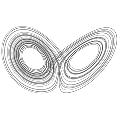
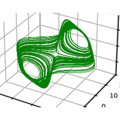
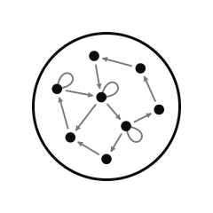
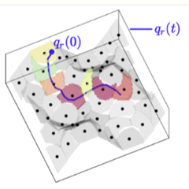

Documentation of my Python packages, with tutorials and live demos.

  

    <h2 class="project-name"><a href="https://andreanovoa.github.io/dynamodels/" target="_blank" rel="noopener noreferrer" style="color:inherit;text-decoration:none">dynamodels</a></h2>
    
Dynamical-system models with history tracking and pluggable integrators.

    
  

  

    <h2 class="project-name"><a href="https://andreanovoa.github.io/ntsa/" target="_blank" rel="noopener noreferrer" style="color:inherit;text-decoration:none">ntsa</a></h2>
    
Nonlinear time-series analysis: Lyapunov exponents, delay embedding and regime classification.

    
  

  

    <h2 class="project-name"><a href="https://andreanovoa.github.io/EchoStateNetwork/" target="_blank" rel="noopener noreferrer" style="color:inherit;text-decoration:none">echostatenetwork</a></h2>
    
Echo state networks in pure numpy, with Jacobians for data assimilation.

    
  

  

    <h2 class="project-name"><a href="https://andreanovoa.github.io/real-time-bias-aware-DA/" target="_blank" rel="noopener noreferrer" style="color:inherit;text-decoration:none">romda</a></h2>
    
Real-time reduced-order modelling and bias-aware data assimilation.

    
  

  

    <h2 class="project-name"><a href="https://andreanovoa.github.io/qlroms-docs/" target="_blank" rel="noopener noreferrer" style="color:inherit;text-decoration:none">qlroms</a></h2>
    
Quantized-local reduced-order models with intrusive Galerkin projection.

    
  

