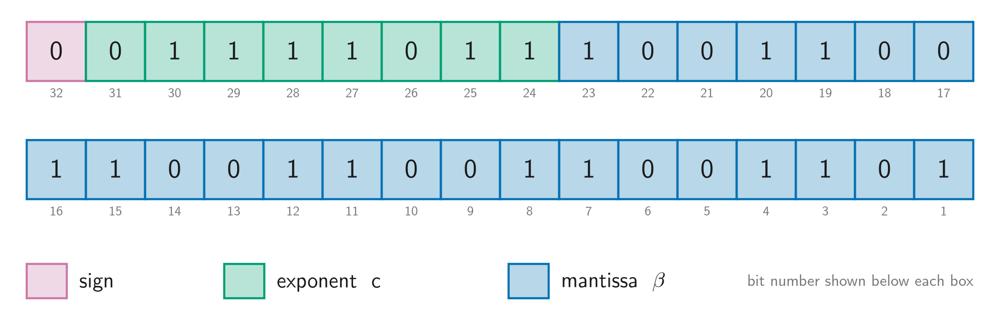
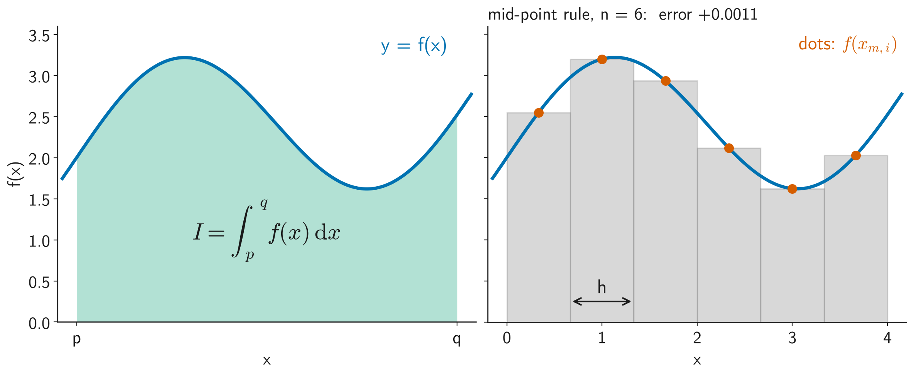
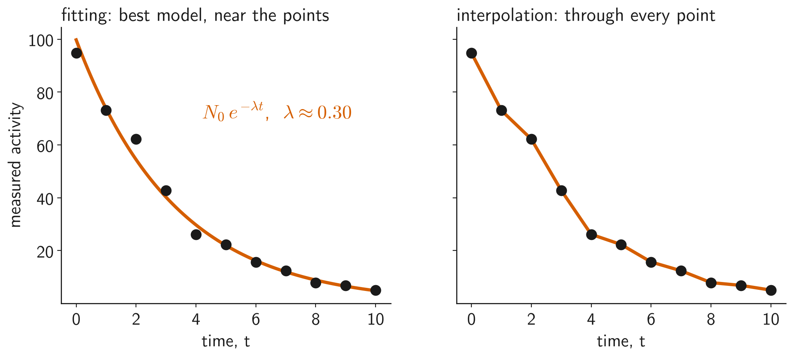

First-year module, Department of Aeronautics, Imperial College London. Four classes on
the numerical methods engineers use when an equation has no closed-form solution. Each
class has interactive demos: step through every iteration, change the inputs, and
compare the methods. The lecture slides and notes are on Blackboard.

  

    <h2 class="project-name"><a href="class1/" target="_blank" rel="noopener noreferrer" style="color:inherit;text-decoration:none">1. How computers count</a></h2>
    
Binary representation, integer and floating-point storage, rounding and chopping, overflow and underflow, and how errors propagate through a calculation.

    
  

  

    <h2 class="project-name"><a href="class2/" target="_blank" rel="noopener noreferrer" style="color:inherit;text-decoration:none">2. Solving unsolvable equations</a></h2>
    
Root finding: bisection, Newton–Raphson, the secant method and fixed-point iteration, with their convergence and failure modes.

    
    <!-- 

      
Open the demos here: bisection, Newton, secant, cobweb diagrams and a comparison of all four

      <iframe class="project-embed" src="class2/" loading="lazy" title="Root-finding demos"></iframe>
    
 -->
  

  

    <h2 class="project-name"><a href="class3/" target="_blank" rel="noopener noreferrer" style="color:inherit;text-decoration:none">3. Integrating unintegrable functions</a></h2>
    
Numerical integration: Riemann sums, the trapezium rule, Simpson's rule, Newton–Cotes formulae and Gauss–Legendre quadrature.

    
  

  

    <h2 class="project-name"><a href="class4/" target="_blank" rel="noopener noreferrer" style="color:inherit;text-decoration:none">4. Curve fitting and interpolation</a></h2>
    
Polynomial interpolation in the monomial, Newton and Lagrange forms, why they give the same polynomial, and cubic splines.

    
  

