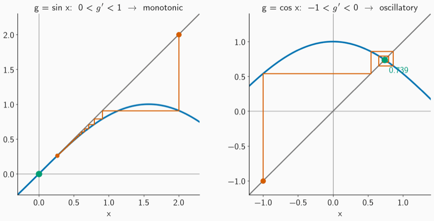

AERO40003 Computing and Numerical Methods 1 · Class 2

Interactive demos for finding roots of <i>f</i>(x) = 0. Step through every iteration, change the inputs, and compare the methods.

<!--  -->

  

    
<svg class="module-demo-icon" viewBox="0 0 96 72" aria-hidden="true"><path d="M9 55H87M16 50L76 16" fill="none" stroke="#0072B2" stroke-width="3"/><path d="M18 22V61M78 22V61" stroke="#D55E00" stroke-width="3"/><circle cx="48" cy="39" r="5" fill="#009E73"/><path d="M18 61H78" stroke="#767676" stroke-width="2"/></svg>Bisection

    <iframe class="module-demo-frame" src="bisection.html" title="Bisection demo" loading="lazy"></iframe>
  

  

    
<svg class="module-demo-icon" viewBox="0 0 96 72" aria-hidden="true"><path d="M9 60H88M13 61C28 60 34 48 43 28S63 18 84 10" fill="none" stroke="#0072B2" stroke-width="3"/><path d="M31 48L70 18" stroke="#D55E00" stroke-width="3"/><circle cx="48" cy="35" r="4.5" fill="#009E73"/><path d="M48 35V60" stroke="#767676" stroke-width="2" stroke-dasharray="4 4"/></svg>Newton’s method

    <iframe class="module-demo-frame" src="newton.html" title="Newton’s method demo" loading="lazy"></iframe>
  

  

    
<svg class="module-demo-icon" viewBox="0 0 96 72" aria-hidden="true"><path d="M8 58H88M12 61C27 59 30 43 43 24S68 20 85 9" fill="none" stroke="#0072B2" stroke-width="3"/><path d="M21 51L72 18" stroke="#D55E00" stroke-width="3"/><circle cx="21" cy="51" r="4.5" fill="#009E73"/><circle cx="72" cy="18" r="4.5" fill="#009E73"/></svg>Secant method

    <iframe class="module-demo-frame" src="secant.html" title="Secant method demo" loading="lazy"></iframe>
  

  

    
<svg class="module-demo-icon" viewBox="0 0 96 72" aria-hidden="true"><path d="M12 60H87M17 62C28 57 35 39 45 22S67 17 84 9M12 60L84 9M12 60V12" fill="none" stroke="#0072B2" stroke-width="3"/><path d="M68 19V26H56V31H47V38H39V43" fill="none" stroke="#D55E00" stroke-width="2.5"/><circle cx="68" cy="19" r="3.5" fill="#009E73"/><circle cx="56" cy="26" r="3.5" fill="#009E73"/><circle cx="47" cy="31" r="3.5" fill="#009E73"/></svg>Fixed-point iteration

    <iframe class="module-demo-frame" src="fixed-point.html" title="Fixed-point iteration demo" loading="lazy"></iframe>
  

  

    
<svg class="module-demo-icon" viewBox="0 0 96 72" aria-hidden="true"><path d="M8 61H88M12 56C28 55 34 39 45 21S68 18 85 8" fill="none" stroke="#0072B2" stroke-width="2.5"/><path d="M12 58L82 13" fill="none" stroke="#D55E00" stroke-width="2.5"/><path d="M12 58C32 56 47 35 58 23S74 16 85 10" fill="none" stroke="#009E73" stroke-width="2.5"/><path d="M12 58C35 56 54 44 85 10" fill="none" stroke="#767676" stroke-width="2.5" stroke-dasharray="5 4"/></svg>Compare all four methods

    <iframe class="module-demo-frame" src="compare.html" title="Comparison of the four root-finding methods" loading="lazy"></iframe>
  

  

    
<svg class="module-demo-icon" viewBox="0 0 96 72" aria-hidden="true"><path d="M10 10C24 44 36 52 48 52S72 44 86 10" fill="none" stroke="#0072B2" stroke-width="3"/><path d="M8 64H88" stroke="#767676" stroke-width="2"/><path d="M20 70L76 58" stroke="#D55E00" stroke-width="3"/><path d="M48 52V64" stroke="#767676" stroke-width="2" stroke-dasharray="4 4"/><circle cx="48" cy="52" r="5" fill="#009E73"/></svg>Further: minimisation is root finding

    <iframe class="module-demo-frame" src="optimisation.html" title="Minimisation as root finding demo" loading="lazy"></iframe>
  

